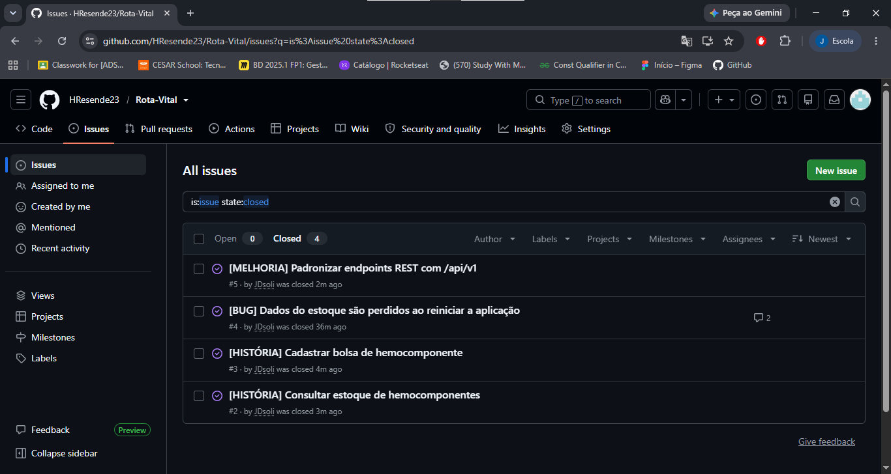

# 🩸 Rota Vital — Gestão e Distribuição de Hemocomponentes

O **Rota Vital** é uma aplicação web desenvolvida em **Java com Spring Boot** para apoiar o controle, a rastreabilidade e a distribuição de hemocomponentes entre hemocentros e unidades hospitalares.

O projeto busca reduzir desperdícios por vencimento, melhorar a visualização do estoque e apoiar o atendimento de solicitações hospitalares, especialmente em situações de urgência.

---

## 🛠️ Tecnologias utilizadas

### Backend
- Java
- Spring Boot
- Spring Web
- Spring Data JPA
- Hibernate
- Bean Validation
- Maven

### Banco de dados
- PostgreSQL

### Frontend
- HTML5
- CSS3

### Versionamento e gestão
- Git
- GitHub
- GitHub Issues / Bug Tracker

---

## 📁 Estrutura atual do projeto

```text
Rota-Vital/
├── src/
│   ├── main/
│   │   ├── java/br/com/rotavital/
│   │   │   ├── controller/
│   │   │   │   └── EstoqueController.java
│   │   │   ├── model/
│   │   │   │   ├── BolsaHemoComponente.java
│   │   │   │   ├── StatusBolsa.java
│   │   │   │   ├── TipoComponente.java
│   │   │   │   └── TipoSanguineo.java
│   │   │   ├── repository/
│   │   │   │   └── BolsaHemoComponenteRepository.java
│   │   │   ├── service/
│   │   │   │   └── EstoqueService.java
│   │   │   └── RotaVitalApplication.java
│   │   └── resources/
│   │       ├── static/
│   │       │   ├── index.html
│   │       │   ├── requisicao.html
│   │       │   ├── alocacao.html
│   │       │   ├── rota.html
│   │       │   └── monitoramento.html
│   │       └── application.properties
│   └── test/
├── pom.xml
├── mvnw
├── mvnw.cmd
└── README.md

```
## Estatística e CRISP-DM

A análise estatística do projeto Rota-Vital foi estruturada com base no ciclo CRISP-DM, abordando entendimento do problema, análise dos dados de estoque, preparação, modelagem estatística, avaliação e implantação.

- [Apresentação em PDF](docs/entrega-02/Rota-Vital_Estatistica_CRISP-DM.pdf)
- [Apresentação em PowerPoint](docs/entrega-02/Rota-Vital_Estatistica_CRISP-DM.pptx)
---


### 🎨 Protótipo no Figma
🔗 [Rota Vital — Entrega 01](https://www.figma.com/design/CZ4BYx3COy4SKGpxZ36Zu1/Rota-Vital-%E2%80%94-Entrega-01?node-id=0-1&p=f&t=bXHbJWjJVn23hN8B-0)


## 🐛 Issue / Bug Tracker

Durante a Entrega 02 foi utilizado o **GitHub Issues** para registrar histórias, bugs e melhorias do projeto.

Issues trabalhadas:

- `#2` — **[HISTÓRIA] Consultar estoque de hemocomponentes**
- `#3` — **[HISTÓRIA] Cadastrar bolsa de hemocomponente**
- `#4` — **[BUG] Dados do estoque são perdidos ao reiniciar a aplicação**
- `#5` — **[MELHORIA] Padronizar endpoints REST com /api/v1**

As quatro issues foram utilizadas durante o desenvolvimento e encerradas após a validação das respectivas implementações.

### Evidência do Issue/Bug Tracker



---

## 🎥 Screencasts da Entrega 03

https://drive.google.com/file/d/1nVxMmE_J_bPVI7s0wxBI1vTj-OuuL3cz/view?usp=sharing

## 👥 Integrantes

| Integrante |
|---|
| Hilton Resende Montes Neto |
| Jardel Simplicio de Oliveira Junior |
| Dayanne Cristina Moraes Inacio |
| Rodrigo Cavalcanti Albuquerque Rodrigues dos Santos |

