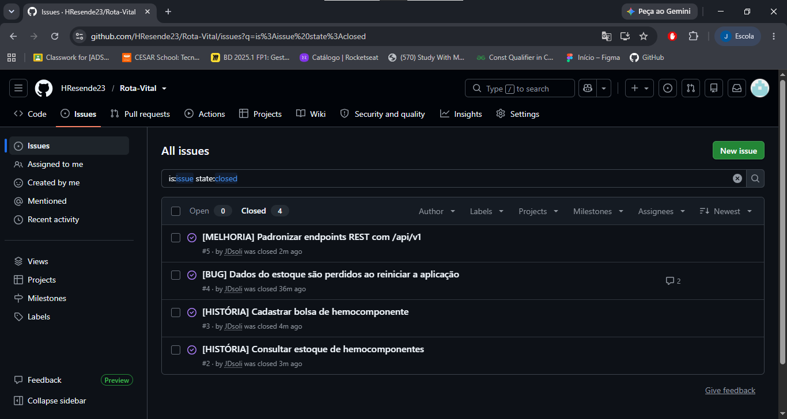
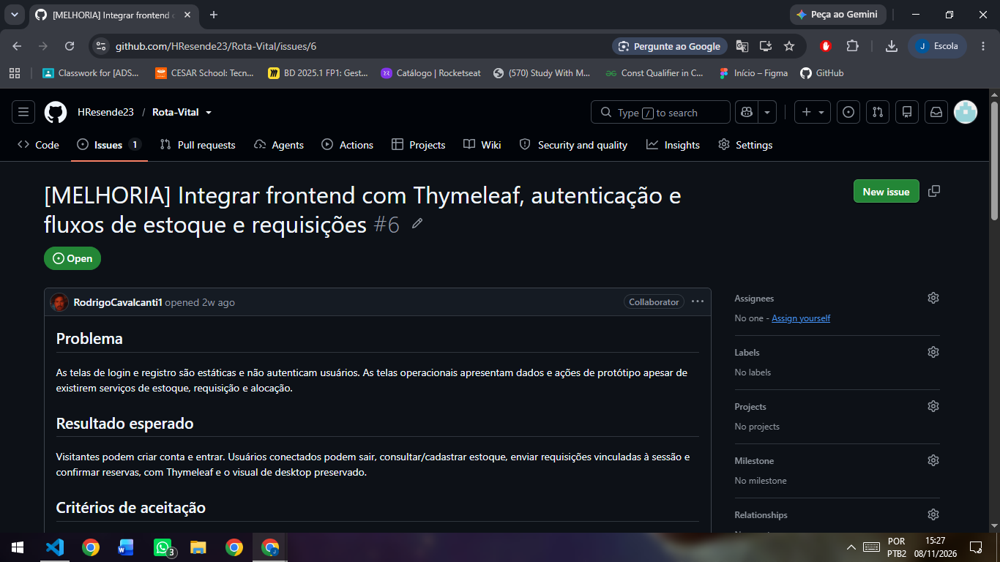

# 🩸 Rota Vital — Gestão e Distribuição de Hemocomponentes

O **Rota Vital** é uma aplicação web desenvolvida em **Java com Spring Boot** para apoiar o controle, a rastreabilidade e a distribuição de hemocomponentes entre hemocentros e unidades hospitalares.

O projeto busca reduzir desperdícios por vencimento, melhorar a visualização do estoque e apoiar o atendimento de solicitações hospitalares, especialmente em situações de urgência.

---

## 🛠️ Tecnologias utilizadas

### Backend
- Java
- Spring Boot
- Spring Web
- Spring Data JPA
- Spring Security
- Hibernate
- Bean Validation
- Maven

### Banco de dados
- PostgreSQL (aplicação) e H2 (testes)

### Frontend
- Thymeleaf
- HTML5
- CSS3 (identidade vermelho e branco, responsiva)
- SVG (logo e mapa de rotas)

### Execução
- Docker e Docker Compose

### Versionamento e gestão
- Git
- GitHub
- GitHub Issues / Bug Tracker

---

## 📁 Estrutura atual do projeto

```text
Rota-Vital/
├── src/
│   ├── main/
│   │   ├── java/br/com/rotavital/
│   │   │   ├── config/        # Spring Security e relógio da aplicação
│   │   │   ├── controller/    # telas Thymeleaf e APIs REST /api/v1
│   │   │   ├── dto/           # formulários e respostas
│   │   │   ├── model/         # bolsa, requisição, remessa, leitura, malha viária
│   │   │   ├── repository/    # Spring Data JPA
│   │   │   ├── service/       # estoque, alocação, monitoramento, rota
│   │   │   └── RotaVitalApplication.java
│   │   └── resources/
│   │       ├── templates/     # login, registro, estoque, requisição, alocação, rota, monitoramento
│   │       ├── static/        # css, js e img (logo e favicon)
│   │       └── application.properties
│   └── test/                  # testes de domínio, integração e fluxo web (H2)
├── docs/                      # histórias e documentação de cada entrega
├── Dockerfile
├── compose.yaml
└── pom.xml
```
## Executar com Docker

Pré-requisitos: Git e Docker com o plugin Compose. No Windows, instale e abra
o Docker Desktop antes de executar os comandos. Não é necessário instalar Java,
Maven ou PostgreSQL na máquina para usar este modo.

```bash
git clone https://github.com/HResende23/Rota-Vital.git
cd Rota-Vital
docker compose up --build
```

Se já possui o projeto, execute apenas o último comando na pasta que contém
`Dockerfile`, `compose.yaml` e `pom.xml`. A primeira execução baixa as imagens e
as dependências, podendo levar alguns minutos. Libere a porta 8080 caso outra
instância da aplicação esteja utilizando-a.

O Dockerfile compila o projeto e executa `mvn -B -ntp clean verify` antes de gerar
a imagem da aplicação. Uma falha nos testes interrompe o build. Se as entradas
do build não mudarem, o Docker pode reutilizar essa etapa do cache.

O Compose inicia dois serviços: `db` (PostgreSQL 17) e `app` (Spring Boot com
Java 17). A aplicação aguarda o banco ficar saudável e conecta-se a
`jdbc:postgresql://db:5432/rotavital`. O banco do container é independente de um
PostgreSQL instalado na máquina e não publica sua porta 5432 no host.

Quando aparecer `Started RotaVitalApplication`, acesse
[http://localhost:8080](http://localhost:8080). Mantenha o terminal aberto;
`Ctrl + C` encerra a execução em primeiro plano.

### Comandos úteis

Execute na pasta do projeto. Se o terminal estiver acompanhando os logs, abra
outro terminal nessa mesma pasta.

```bash
# Iniciar em segundo plano, liberando o terminal
docker compose up --build -d

# Consultar os containers e suas situações
docker compose ps

# Ver as últimas mensagens da aplicação
docker compose logs --tail=50 app

# Encerrar e remover os containers e a rede do projeto
docker compose down
```

Os dados do PostgreSQL ficam no volume `postgres_data` e são preservados por
`docker compose down`. O comando `docker compose down -v` também apaga o volume
e seus dados; use-o somente quando quiser limpar o banco deste ambiente.

As credenciais `postgres` / `rotavital_local` presentes no Compose são destinadas
ao desenvolvimento local. A conexão definida no Compose substitui a configuração
local de banco da aplicação.

### Testes automatizados

Com Java compatível instalado, execute a suíte completa sem iniciar os containers:

```powershell
# Windows PowerShell
.\mvnw.cmd clean verify
```

```bash
# Git Bash, Linux ou macOS
sh mvnw clean verify
```

Os testes usam H2 em modo PostgreSQL e não alteram o banco da aplicação.
A suíte contém 333 testes (Entrega 05). Consulte
[a documentação da refatoração e dos testes](docs/backend-tdd.md) para detalhes.

### Versão da entrega

A tag [ENTREGA-SO](https://github.com/HResende23/Rota-Vital/tree/ENTREGA-SO)
identifica a versão que reúne os testes e a refatoração do backend, a
conteinerização com Docker e Compose e estas instruções de execução.

## Estatística e CRISP-DM

A análise estatística do projeto Rota-Vital foi estruturada com base no ciclo CRISP-DM, abordando entendimento do problema, análise dos dados de estoque, preparação, modelagem estatística, avaliação e implantação.

- [Apresentação em PDF](docs/entrega-02/Rota-Vital_Estatistica_CRISP-DM.pdf)
- [Apresentação em PowerPoint](docs/entrega-02/Rota-Vital_Estatistica_CRISP-DM.pptx)
---


### 🎨 Protótipo no Figma
🔗 [Rota Vital — Entrega 01](https://www.figma.com/design/CZ4BYx3COy4SKGpxZ36Zu1/Rota-Vital-%E2%80%94-Entrega-01?node-id=0-1&p=f&t=bXHbJWjJVn23hN8B-0)


## 🐛 Issue / Bug Tracker

Durante a Entrega 02 foi utilizado o **GitHub Issues** para registrar histórias, bugs e melhorias do projeto.

Issues trabalhadas:

- `#2` — **[HISTÓRIA] Consultar estoque de hemocomponentes**
- `#3` — **[HISTÓRIA] Cadastrar bolsa de hemocomponente**
- `#4` — **[BUG] Dados do estoque são perdidos ao reiniciar a aplicação**
- `#5` — **[MELHORIA] Padronizar endpoints REST com /api/v1**

As quatro issues foram utilizadas durante o desenvolvimento e encerradas após a validação das respectivas implementações.

### Evidência do Issue/Bug Tracker




## 🎥 Screencasts da Entrega 03

https://drive.google.com/file/d/1nVxMmE_J_bPVI7s0wxBI1vTj-OuuL3cz/view?usp=sharing

---
## 📦 Entrega 04

Nesta entrega foram implementadas melhorias de autenticação e integração da interface web com os fluxos principais do sistema.

### Histórias implementadas

- **História 05 — Cadastro e autenticação de usuários - Diferenciações entre @logged e não logado utilizando spring security para retorno adequado de telas apenas para usuários logados na aplicação **
- **História 06 — Utilização dos fluxos do sistema pela interface web**

📄 [Documentação das histórias da Entrega 04](docs/entrega-04/historias.md)

## 🎥 Screencasts da Entrega 04 Mostrando o fluxo da informação no backend após usuário logado - requisição de bolsas e conferir estoque:

 https://youtu.be/tQ7MXJwF-qw

### Issue / Bug Tracker

- `#6` — **Integração web, autenticação e fluxos de estoque e requisições**

### Evidência do Issue/Bug Tracker



### Interface web integrada e autenticação

Abra a aplicação em [http://localhost:8080/](http://localhost:8080/).
Visitantes são encaminhados ao login. Use **Criar conta** para registrar nome,
e-mail e senha; depois entre para consultar/cadastrar estoque, enviar requisições
e confirmar reservas. O botão **Sair** encerra a sessão.

As sete telas são renderizadas por Thymeleaf em
`src/main/resources/templates`; CSS e JavaScript permanecem em `static`.
Os caminhos antigos `*.html` são preservados por controllers.

- Registro: `GET/POST /registro`.
- Login: `GET/POST /login`; logout: `POST /logout`.
- Estoque: `GET /estoque`, filtros de componente/tipo e `POST /bolsas`.
- Requisições: `GET /requisicao` e `POST /requisicoes`.
- Alocação: `GET /alocacao?requisicaoId=ID` e `POST /alocacao/{id}/reserva`.
- Rota e monitoramento continuam demonstrações identificadas na interface.

Senhas são armazenadas somente como BCrypt. As páginas operacionais e APIs
exigem sessão autenticada; formulários POST são protegidos por CSRF.
Requisições são vinculadas ao usuário conectado, que só pode consultar/reservar
suas próprias solicitações. As APIs preservam `/api/v1`, mas requisições não
autenticadas recebem 401; mutações exigem CSRF. A criação REST de requisição
mantém `usuarioId` no JSON e exige que seja o ID da sessão.

A API `POST /api/v1/usuarios` anterior continua protegida por login e cadastra
somente nome/e-mail. Para uma conta capaz de entrar, use o registro web.
Usuários antigos sem senha e requisições antigas sem vínculo são preservados,
sem senha padrão ou atribuição automática.

Reinicie/recompile a aplicação após atualizar. Se usar Docker:

```bash
docker compose up --build
```

**Documentação detalhada:** [Integração web e Thymeleaf](docs/integracao-web-thymeleaf.md).
**Issue de acompanhamento:** [#6 — Integração web e autenticação](https://github.com/HResende23/Rota-Vital/issues/6).

---
## 📦 Entrega 05

As telas de **Rota** e **Monitoramento** deixaram de ser demonstrações e passaram a usar o
backend. O monitoramento é ligado à alocação: **assim que a reserva é confirmada, a remessa é
aberta e o sensor da caixa térmica passa a ser monitorado**. Todas as telas receberam a
identidade vermelho e branco, com o logo Rota Vital no canto superior esquerdo.

### Histórias implementadas

- **História 07 — Monitorar a cadeia fria da remessa:** leituras do sensor, faixa térmica por
  componente, desvio, alerta térmico com bloqueio das bolsas, reconhecimento do alerta e
  encerramento na entrega.
- **História 08 — Planejar a rota de entrega:** comparação de caminhos na malha sintética,
  horário de pico, critérios de viabilidade (janela do hospital, capacidade da caixa, autonomia
  térmica e validade das bolsas) e confirmação do caminho viável mais rápido.
- **Melhoria — Identidade visual e responsividade** em todas as telas.

📄 [Documentação das histórias da Entrega 05](docs/entrega-05/historias.md)

### Fluxo completo

```text
Estoque → Requisição → Alocação (reserva) → Remessa aberta + monitoramento
        → Rota planejada → Em transporte → Entregue
        (2 leituras seguidas fora da faixa → Pendente de avaliação, bolsas bloqueadas)
```

### Rotas novas

| Tela / API | Caminho |
|---|---|
| Rota | `GET /rota`, `POST /rota/{id}/planejamento` |
| Monitoramento | `GET /monitoramento`, `POST /monitoramento/{id}/leituras`, `.../alerta/reconhecimento`, `.../transporte`, `.../entrega` |
| API de remessas | `GET /api/v1/remessas`, `GET /api/v1/remessas/{id}`, `POST /api/v1/remessas/{id}/leituras` |
| API de rota | `GET /api/v1/remessas/{id}/rota/alternativas`, `POST /api/v1/remessas/{id}/rota` |
| API de situação | `POST /api/v1/remessas/{id}/alerta/reconhecimento`, `.../transporte`, `.../entrega` |

As APIs seguem as regras anteriores: sessão autenticada, CSRF nas mutações e acesso somente
às remessas das próprias requisições.

Depois de atualizar, reconstrua a imagem:

```bash
docker compose up --build
```

As tabelas novas (`remessa` e `leitura_temperatura`) são criadas automaticamente; os dados
existentes são preservados. Requisições alocadas antes desta entrega mostram o botão
**Iniciar monitoramento** na tela de alocação.

## 👥 Integrantes

| Integrante |
|---|
| Hilton Resende Montes Neto |
| Jardel Simplicio de Oliveira Junior |
| Dayanne Cristina Moraes Inacio |
| Rodrigo Cavalcanti Albuquerque Rodrigues dos Santos |


